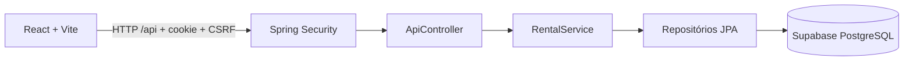

# Rota — Sistema de Aluguel de Carros

Protótipo acadêmico para cadastrar clientes, administrar frota, solicitar aluguéis, registrar pareceres de empresa/banco e formalizar contratos de aluguel e crédito.

Projeto da disciplina Desenvolvimento e Integração de Aplicações Web — LAB02, baseado no [enunciado do professor João Paulo Aramuni](https://github.com/joaopauloaramuni/desenvolvimento-e-integracao-de-aplicacoes-web/blob/main/LABORATORIOS/DIAW_-_LABORATO%CC%81RIO_02_-_Sistema_de_Aluguel_de_Carros.pdf). Documentação organizada a partir do [template indicado](https://github.com/joaopauloaramuni/desenvolvimento-e-integracao-de-aplicacoes-web/blob/main/TEMPLATES/template_README.md), adaptado ao escopo web.

## Status e links

Implementação local de cadastro/login, CRUD do próprio cliente, frota, pedidos, avaliação e contratos. Histórico de validação em [docs/VALIDACAO.md](docs/VALIDACAO.md). Não há URL pública de demonstração confirmada.

- [Repositório](https://github.com/arthurcosta7/AluguelDeCarros)
- [Modelos UML, histórias e evolução](docs/modelos/README.md)
- [Regras de negócio e API](docs/REGRAS.md)
- [Relatório de conformidade original](docs/RELATORIO_CONFORMIDADE_LAB02.md)
- [Complementação da entrega](docs/COMPLEMENTACAO_LAB02.md)

## Funcionalidades

| Perfil | Operações |
| --- | --- |
| Cliente | Cadastro, consulta e edição dos próprios dados; exclusão de conta sem vínculos com senha; consultar frota; criar, alterar, consultar e cancelar pedidos próprios; aceitar condições aprovadas; consultar e imprimir contratos. |
| Empresa | Cadastrar/editar frota própria, indicar proprietário, consultar/modificar/avaliar pedidos da empresa e consultar contratos. |
| Banco | Consultar e modificar pedidos vinculados, avaliar crédito após aprovação da empresa e consultar contratos vinculados. |

Dados pessoais: nome, RG, CPF, endereço, profissão e até três empregadores/rendimentos. Cliente com qualquer pedido ou veículo vinculado não pode excluir a conta, para preservar o histórico. Exclusão encerra a sessão. O cadastro público nunca cria agentes.

## Tecnologias

Java 25; Spring Boot 4.0.9; Spring MVC, Security e Data JPA; Maven Wrapper; Flyway; React 19; Vite 8; PostgreSQL no Supabase. H2 é usado apenas nos testes. Node 22.12+ ou versão compatível com Vite 8 e npm são necessários no frontend.

## Arquitetura

View: React no navegador. Controllers: API HTTP Spring MVC. Model: entidades, regras em RentalService e persistência por repositórios JPA. JSON conecta a interface ao backend. Spring Security controla sessão e CSRF; autenticação não usa Supabase Auth. O backend acessa PostgreSQL por JDBC/TLS.



Consulte os [diagramas de classes, casos de uso e pacotes](docs/modelos/README.md). A documentação V1 foi reconstruída a partir do commit-base e está identificada como tal; não foi apresentada como material original anterior ao código.

## Instalação e execução

### 1. Banco e configuração

Crie/use um projeto Supabase destinado ao protótipo. Copie os dados de conexão **Session pooler** do painel; não confunda a senha do banco com a chave pública/API key. O pooler é útil em redes sem IPv6.

Copie `aluguel/.env.example` para `aluguel/.env` e preencha `DB_URL`, `DB_USERNAME` e `DB_PASSWORD`. Preserve o usuário exato indicado pelo painel. Não coloque credenciais no frontend nem no GitHub. Variáveis já exportadas no terminal prevalecem sobre o `.env`.

As migrações Flyway são executadas na inicialização, no schema `locadora`: V1 estrutura inicial; V2 proteção PostgreSQL; V3 contrato de crédito e conversão de contratos antigos com crédito; V4 proteção da nova tabela. Hibernate valida o schema. Não execute scripts manualmente nem apague o histórico Flyway para atualizar uma instalação existente.

### 2. Backend — terminal 1

```bash
cd aluguel
./run.sh
```

O launcher exige Python 3 e carrega o `.env`, depois executa o Maven. O backend usa `http://localhost:8080`. É necessário acesso ao Maven Central na primeira execução. No Windows, configure as variáveis no terminal e use `mvnw.cmd spring-boot:run`.

### 3. Frontend — terminal 2

```bash
cd front/AluguelVeículos
npm ci
npm run dev
```

Abra a URL exibida pelo Vite, normalmente `http://localhost:5173`. O proxy encaminha `/api` para `http://localhost:8080`. Backend e frontend precisam estar ligados; executar apenas o Vite causa erro de conexão. Não use Live Server para abrir a aplicação.

### 4. Preparar agentes e frota para apresentação

Em banco **de demonstração**, habilite `DEMO_ENABLED=true` e defina uma `DEMO_PASSWORD` local com ao menos 8 caracteres antes de iniciar o backend. A carga cria `empresa`, `banco` e `cliente` e três veículos se a frota estiver vazia. Todas as contas novas usam a senha definida. A carga não redefine senhas de contas existentes.

Depois da carga, desabilite `DEMO_ENABLED`. Não publique a senha. Alternativamente, a instituição pode provisionar contas EMPRESA/BANCO administrativamente. Não há tela pública de criação de agentes, evitando que clientes se promovam para esses papéis.

## Demonstração do fluxo

1. Cadastre um cliente, entre e consulte Minha conta.
2. Edite nome, endereço, profissão e empregadores; salve e confira os dados.
3. Consulte a frota, selecione datas futuras e solicite um veículo.
4. Para testar crédito, selecione o banco, um valor até o total e parcelas entre 1 e 60.
5. Saia e entre como empresa. Abra o pedido e dê parecer positivo com justificativa.
6. Havendo crédito, entre como banco e aprove o pedido que estiver aguardando sua análise.
7. Volte ao cliente, confira as condições aprovadas e aceite.
8. Nos detalhes, confira contrato de aluguel e, quando houver crédito, contrato de crédito independente. Use Imprimir contratos para impressão/PDF pelo navegador.
9. Em outro pedido, teste alteração, rejeição/reenvio e cancelamento. Em uma conta nova sem vínculos, teste exclusão com confirmação de senha.

Análise é manual pelos agentes. Não há pagamento, juros, desembolso bancário, assinatura com certificado ou transferência automática de propriedade. Os documentos são registros acadêmicos.

## Testes e build

```bash
cd aluguel
./mvnw test
```

```bash
cd front/AluguelVeículos
npm run lint
npm run build
node --test --test-isolation=none tests/api.test.js
```

Os testes Spring usam H2 em memória e não as credenciais Supabase. Cobrem sessão/CSRF, cadastro, permissões, disponibilidade, concorrência, aprovação, snapshots contratuais e CRUD próprio. Resultados e limites em [VALIDACAO.md](docs/VALIDACAO.md).

## Estrutura

```text
aluguel/
  src/main/java/.../api/          Controllers, DTOs, erros
  src/main/java/.../config/       Segurança e dados de demonstração
  src/main/java/.../domain/       Entidades e enumerações
  src/main/java/.../service/      Regras de negócio
  src/main/java/.../repository/   Persistência JPA
  src/main/resources/db/          Migrações
  src/test/                      Integração com H2/MockMvc
front/AluguelVeículos/
  src/                           Páginas, componentes, API e estilos
  tests/                         Testes da camada HTTP
  public/                        Ícones
 docs/                           Regras, validação e modelagem
 design-system/                  Diretrizes visuais e movimento
```

## Deploy

Esta entrega não publica automaticamente o site. Para produção, configure uma origem que sirva o frontend e encaminhe `/api` ao backend, banco acessível por TLS, variáveis no servidor e `COOKIE_SECURE=true` em HTTPS. `API_TARGET` pode ser definido no terminal do Vite para usar outra porta de backend em testes (padrão: `http://localhost:8080`). `vite preview` é para conferir build local e não substitui hospedagem de produção. Confirme fluxo de cookies/CSRF na URL final.

## Autoria e colaboração

Repositório mantido por [arthurcosta7](https://github.com/arthurcosta7). Integrantes adicionais e dados da turma não foram informados; devem ser registrados pelos responsáveis antes da apresentação. Não foi atribuída autoria acadêmica fictícia.

Preserve modelos, datas e autoria reais. Execute os testes antes de alterações e não envie `.env`, senhas ou dados pessoais reais. Nenhuma licença de distribuição foi declarada no projeto; não se presume uma licença ausente.

## Conta com alternância para apresentação

O operador pode definir `PRESENTATION_USERNAME=arthur` no `.env` do backend e reiniciá-lo. A conta cliente deve existir. No cabeçalho, “Perfil da apresentação” permite alternar entre Cliente, Empresa e Banco sem trocar a senha nem sair. A conta original continua cliente; a sessão seleciona identidades vinculadas `arthur.empresa` e `arthur.banco`, criadas com senhas aleatórias não divulgadas. Não existe administrador geral nem alteração pública de perfil. Somente a conta configurada pode alternar.

Para demonstrar o ciclo completo, alterne para Empresa e cadastre um veículo; volte a Cliente e solicite esse veículo com crédito do banco “Arthur · Banco” (o nome usa o cadastro original); aprove como Empresa, depois como Banco, e volte a Cliente para aceitar os contratos. Os pedidos e veículos permanecem associados às respectivas identidades. Outras empresas e bancos continuam isolados. A seleção é por sessão e um novo login começa no perfil Cliente.

Para desabilitar, remova `PRESENTATION_USERNAME` e reinicie. As identidades vinculadas e seus históricos são preservados. A conta original não pode ser excluída enquanto a alternância estiver habilitada.
