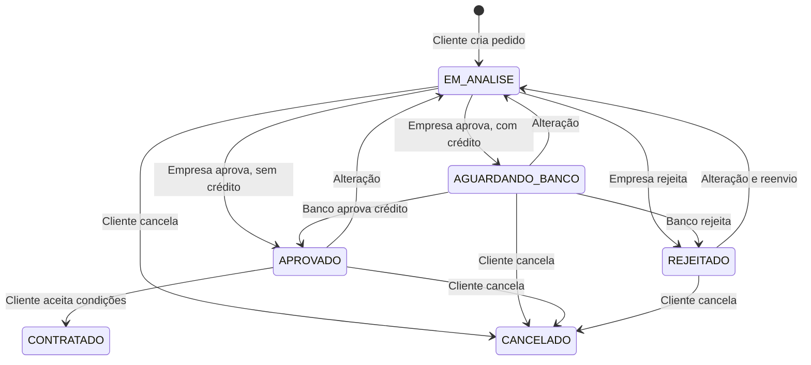

# Regras e API

## Perfis e permissões

| Operação | Cliente | Empresa | Banco |
| --- | --- | --- | --- |
| Consultar veículos e disponibilidade | Sim | Sim | Sim |
| Cadastrar/alterar veículos | Não | Apenas sua frota | Não |
| Criar pedido | Sim, em seu nome | Não | Não |
| Consultar/alterar pedido | Próprios | Da sua empresa | Com crédito atribuído ao seu banco |
| Avaliar aluguel | Não | Da sua empresa, em análise | Não |
| Avaliar crédito | Não | Não | Do seu banco, após aprovação da empresa |
| Cancelar pedido | Próprios, antes do contrato | Não | Não |
| Formalizar contrato | Próprios e aprovados | Não | Não |
| Consultar contrato | Próprios | Da sua empresa | Com crédito do seu banco |

Todas as operações de negócio exigem autenticação. O backend verifica as permissões a cada requisição, inclusive ao consultar um identificador diretamente. O cadastro de cliente inclui RG, CPF, nome, endereço, profissão e zero a três empregadores, cada um com renda mensal não negativa. A lista de proprietários para cadastro da frota contém apenas identificador, nome e perfil.

## Estados do pedido

- Agentes podem alterar veículo, datas e condições de crédito, respeitando a empresa responsável. O banco não pode redirecionar um pedido para outro banco nem remover sua associação de crédito.
- Toda alteração de condições volta para `EM_ANALISE` e exige novos pareceres. Dados pessoais do cliente não são alterados por agentes.
- Pareceres exigem justificativa. O histórico registra autor, momento, ação e condições anteriores e posteriores nas alterações.
- Pedidos cancelados e contratados são somente consulta. Rejeitados podem ser corrigidos e reenviados pelo fluxo de alteração.
- O aceite gera exatamente um contrato por pedido, com cópia das condições, identificação das partes e proprietário do carro. Essa cópia permanece estável mesmo se os cadastros mudarem depois.

## Datas, valores e concorrência

- Escolha de veículo específico, com retirada e devolução por data, sem horário.
- Retirada a partir de hoje; devolução estritamente posterior. São cobradas as noites/dias entre as datas: de 10 a 12 são duas diárias.
- Intervalo `[retirada, devolução)`: um carro devolvido dia 12 pode ser reservado por outro cliente a partir do dia 12.
- Pedidos em análise, aguardando banco, aprovados e contratados ocupam o intervalo. Rejeição ou cancelamento libera as datas.
- O total é calculado no servidor: diária cadastrada × quantidade de dias. O cliente não define o preço.
- Crédito opcional de valor positivo até o total do aluguel, com banco e 1 a 60 parcelas, sem juros nesta demonstração. O saldo restante é registrado no contrato, sem cobrança integrada.
- A linha do veículo é bloqueada dentro da transação antes de conferir disponibilidade e salvar o pedido. Assim, duas requisições simultâneas não reservam o mesmo carro no mesmo intervalo.
- Toda alteração, avaliação, cancelamento e aceite exige a versão atual do pedido. Uma ação baseada em condições antigas recebe HTTP 409 e deve ser refeita após atualização.
- Veículos com pedidos ativos não podem ter o cadastro alterado.

## Autenticação

Usuário normalizado em letras minúsculas; senha com pelo menos 8 caracteres, armazenada com BCrypt. Sessão de 30 minutos, cookie HttpOnly e SameSite=Lax. CSRF permanece ativo. O frontend obtém um token antes de cada mutação, inclusive login e cadastro. Isso também renova o token após login/logout, conforme a [orientação do Spring Security](https://docs.spring.io/spring-security/reference/7.0/servlet/exploits/csrf.html).

## Endpoints

Base: `/api`. Entradas e respostas de negócio em JSON; login usa `application/x-www-form-urlencoded`. Operações POST/PUT exigem o cabeçalho CSRF informado por `/auth/csrf`. Login e logout retornam 204.

| Método | Caminho | Finalidade |
| --- | --- | --- |
| GET | `/auth/csrf` | Obter token e nome do cabeçalho CSRF |
| POST | `/auth/register` | Cadastrar cliente |
| POST | `/auth/login` | Entrar com campos `username` e `password` |
| GET | `/auth/me` | Consultar usuário atual |
| POST | `/auth/logout` | Encerrar sessão |
| GET | `/banks` | Listar bancos para seleção |
| GET | `/owners` | Listar proprietários, restrito à empresa |
| GET | `/vehicles` | Listar veículos |
| GET | `/vehicles?start=AAAA-MM-DD&end=AAAA-MM-DD` | Filtrar disponibilidade |
| POST | `/vehicles` | Cadastrar veículo |
| PUT | `/vehicles/{id}` | Alterar veículo sem pedidos ativos |
| GET | `/rentals` | Listar pedidos visíveis ao usuário |
| GET | `/rentals/{id}` | Pedido, histórico e contrato |
| POST | `/rentals` | Criar pedido |
| PUT | `/rentals/{id}?version=N` | Alterar e reenviar para análise |
| POST | `/rentals/{id}/evaluate?version=N` | Parecer com `approve` e `note` |
| POST | `/rentals/{id}/cancel?version=N` | Cancelar pedido |
| POST | `/rentals/{id}/accept?version=N` | Aceitar condições e gerar contrato |

Erros retornam `message` e, quando aplicável, `fields`. Códigos principais: 400 para entrada inválida, 401 para falta de sessão, 403 para operação sem permissão, 404 para registro inexistente e 409 para conflito de dados, disponibilidade ou versão.
