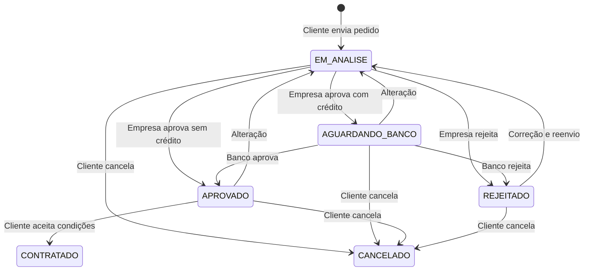
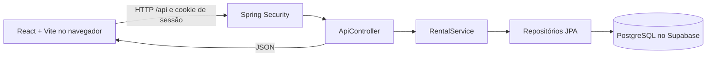

# Rota — relatório de funcionamento e conformidade com o LAB02

**Atualização:** este documento preserva a auditoria anterior às correções. Consulte [a complementação](COMPLEMENTACAO_LAB02.md) para o estado atual, funcionalidades acrescentadas e validações.

Data da análise: 11/11/2026. Escopo: cópia local do projeto, código de frontend/backend, configurações, documentação e testes. Esta análise não atribui nota nem certifica a implantação pública.

## 1. Parecer

**O sistema atende ao fluxo principal de aluguel, mas ainda não atende integralmente à entrega do PDF.** A lacuna funcional mais clara é o CRUD de cliente incompleto: há cadastro e consulta, mas não atualização e exclusão. Também não foram localizados os artefatos de modelagem e o README do projeto exigidos pelo professor.

O crédito está representado por dados associados ao pedido e incorporados ao contrato de aluguel. Isso implementa a solicitação e a aprovação pelo banco, mas a existência de um contrato de crédito independente precisa ser esclarecida e alinhada à modelagem.

Não é adequado calcular um percentual de conformidade sem pesos definidos pelo professor, nem considerar testes aprovados como prova de que todos os requisitos acadêmicos foram entregues.

## 2. Fontes e critérios

- [Enunciado oficial, páginas 1–3](https://github.com/joaopauloaramuni/desenvolvimento-e-integracao-de-aplicacoes-web/blob/main/LABORATORIOS/DIAW_-_LABORATO%CC%81RIO_02_-_Sistema_de_Aluguel_de_Carros.pdf). PDF baixado e texto das três páginas lido nesta análise.
- [Template de README indicado no PDF](https://github.com/joaopauloaramuni/desenvolvimento-e-integracao-de-aplicacoes-web/blob/main/TEMPLATES/template_README.md), consultado nesta análise. Itens opcionais do template não foram tratados como requisitos funcionais obrigatórios.
- [Regras locais](REGRAS.md) e [registro anterior de validação](VALIDACAO.md). O código e a execução atual prevalecem quando esses documentos estão desatualizados.

Legenda: **Atendido no código** significa que a implementação correspondente foi encontrada; **Parcial** indica uma implementação incompleta ou interpretação que exige confirmação; **Não localizado** refere-se aos arquivos locais inspecionados; **Não comprovado** indica falta de evidência suficiente.

## 3. Matriz de conformidade

| Requisito do PDF | Situação | Evidência e observação |
| --- | --- | --- |
| Java JDK 25 | Atendido | `backend/pom.xml` define Java 25; execução de testes com Java 25 nesta sessão. |
| Spring Boot 4.0.x e Maven | Atendido | Parent Spring Boot 4.0.9, dependências e Maven Wrapper em `backend/`. |
| React + Vite | Atendido | Dependências, scripts e componentes em `frontend/`. Build executado com sucesso. |
| Supabase/PostgreSQL | Configurado e conexão observada anteriormente nesta sessão | Driver PostgreSQL, URL por variável e migrações Flyway. Na correção anterior do login, o servidor conectou ao pooler Supabase e aplicou V1/V2. Os testes desta auditoria usam H2 e não certificam a operação completa em PostgreSQL. |
| Cadastro prévio e login obrigatório | Atendido no código e coberto em teste | `SecurityConfig.java` protege operações de negócio; login por usuário/senha, cadastro público de cliente e sessão. |
| Login de clientes e agentes | Atendido no mecanismo; provisionamento limitado | Papéis CLIENTE, EMPRESA e BANCO usam autenticação comum. Cadastro público cria somente CLIENTE. Agentes precisam de provisionamento; há carga demo opcional em `DemoData.java`. Não há tela de cadastro de agentes. |
| Cliente introduz, modifica, consulta e cancela pedidos | Atendido | `RentalService.create/update/bookings/detail/cancel` e páginas correspondentes. Pedidos encerrados ficam bloqueados para edição. |
| Empresas e bancos modificam e avaliam pedidos | Atendido com regras próprias | Agentes só acessam pedidos vinculados. Empresa avalia primeiro; banco avalia pedidos com crédito após aprovação da empresa. Alterações reiniciam a análise. |
| Análise financeira e submissão de parecer positivo ao cliente | Atendido no fluxo | Agentes consultam dados e rendimentos, registram parecer e justificativa. Cliente confirma pedido aprovado para gerar contrato. Não há motor automático de análise financeira, que o PDF não exige expressamente. |
| Dados do contratante: RG, CPF, nome, endereço, profissão | Atendido | `Requests.Registration`, entidade Account, cadastro e detalhes. CPF é validado como 11 dígitos, sem validação dos dígitos verificadores. |
| Até três empregadores e respectivos rendimentos | Atendido | Coleção de empregadores e limite máximo 3 na API e no formulário. A implementação permite zero, pois o PDF explicita máximo, sem estabelecer mínimo. |
| CRUD de cliente | **Parcial — lacuna explícita** | Create: cadastro; Read: Minha conta. Não existem endpoint, serviço ou tela para Update/Delete de cliente. Cancelar pedido não equivale a excluir cliente. |
| Veículo com matrícula, ano, marca, modelo e placa | Atendido | Entidade Vehicle, validações e formulário de frota. Diária é um campo adicional. |
| Veículos de propriedade de cliente, empresa ou banco | Atendido como registro de proprietário | Vehicle.owner referencia Account, permitindo os três papéis; empresa seleciona proprietário. Não há transferência automática da propriedade conforme modalidade de contrato; o PDF não detalha uma regra de transferência. |
| Aluguel associado a contrato de crédito concedido por banco agente | **Parcial / interpretação a confirmar** | Pedido guarda banco, valor e parcelas; banco aprova e o contrato de aluguel incorpora os dados. Não há entidade, identificador ou documento próprio para contrato de crédito. Se o modelo exigir contrato de crédito independente, será necessário implementá-lo. |
| Servidor central ligado aos clientes e agentes via Internet | Arquitetura compatível; implantação não comprovada | Browser acessa API HTTP; Vite encaminha `/api` ao Spring local. Não foi verificada URL pública com acesso de diferentes máquinas, HTTPS ou configuração de produção. |
| Subsistemas de pedidos/contratos e páginas dinâmicas | Atendido na separação de responsabilidades | Backend concentra regras/persistência; React constrói as telas a partir da API. O PDF permite essa subdivisão, sem exigir dois processos adicionais. |
| Arquitetura MVC | Compatível na organização; alinhamento formal pendente | Model: entidades e regras; Controller: API Spring; View: React. DTOs não são templates de tela. A interpretação de MVC distribuído deve estar documentada no diagrama de arquitetura. |
| Protótipo com criação e status do pedido | Atendido | Formulário, lista, detalhes e status textuais. |
| Casos de uso, histórias de usuário, diagrama de classes e pacotes | **Não localizados** | Não foram encontrados os quatro artefatos na cópia local. O diagrama de estados em `REGRAS.md` não substitui esses entregáveis. |
| Revisão e versões dos modelos; comparação entre modelo e código | **Não comprovado** | Sem modelos disponíveis, não é possível verificar evolução ou alinhamento com o código. |
| Repositório GitHub atualizado com modelos e código final | **Não comprovado** | Existe remoto configurado, mas a auditoria não comparou a versão local com os commits remotos. Há alterações locais ainda visíveis no diretório de trabalho. |
| README conforme template indicado | **Não localizado** | Há documentos em `docs/` e um `HELP.md` técnico do backend, mas não um README do projeto seguindo o template. |

## 4. Como o site funciona

### 4.1 Acesso e cadastro

Ao abrir o site, o frontend consulta `/api/auth/me`. Sem sessão válida, exibe login/cadastro. Um novo cliente informa usuário, senha, identificação, endereço, profissão e até três empregadores com renda. Após o cadastro, deve entrar com usuário e senha.

A senha é armazenada com BCrypt. Spring Security mantém a sessão no servidor; o navegador usa cookie HttpOnly e SameSite=Lax. O tempo configurado de sessão é 30 minutos. Antes de operações que alteram dados, o frontend solicita um token CSRF. A autenticação é feita pelo Spring Security, não pelo Supabase Auth.

### 4.2 Navegação e telas

| Tela | Finalidade |
| --- | --- |
| Visão geral | Contadores de pedidos, análise, aprovação e contratos; pedidos recentes. Cliente também recebe atalho para veículos. |
| Veículos | Lista a frota e permite consultar disponibilidade por retirada/devolução. Empresas cadastram e editam os próprios veículos. |
| Meus pedidos / Pedidos | Lista os pedidos que o perfil tem permissão de consultar e permite filtrar a situação. |
| Detalhes do pedido | Mostra veículo, período, valores, contratante, empregadores, crédito, histórico e ações permitidas. |
| Contratos | Lista pedidos contratados. O documento é consultado e impresso nos detalhes. |
| Minha conta | Exibe dados cadastrais; atualmente é somente leitura. |

### 4.3 Jornada do cliente

1. Entrar com uma conta cadastrada.
2. Consultar a frota e informar o período desejado.
3. Selecionar o veículo e criar o pedido.
4. Opcionalmente solicitar crédito, escolhendo banco, valor e parcelas.
5. Enviar o pedido: situação inicial `EM_ANALISE`.
6. Acompanhar os pareceres. Antes da contratação, pode alterar ou cancelar seu pedido, respeitando o estado atual.
7. Se aprovado, revisar os dados e confirmar as condições.
8. Consultar o contrato gerado e usar a impressão do navegador, inclusive salvar como PDF se o navegador oferecer essa opção.

Não existe pagamento integrado, assinatura digital com certificado ou transferência bancária. O aceite eletrônico registra a confirmação no protótipo acadêmico.

### 4.4 Jornada da empresa

A empresa entra com conta de perfil EMPRESA, cadastra a própria frota e define proprietário e diária. Nos pedidos vinculados à sua empresa, consulta os dados do cliente, modifica condições quando permitido e registra parecer com justificativa. Aprovar sem crédito libera o aceite pelo cliente; aprovar com crédito encaminha ao banco. Rejeitar libera o período reservado.

### 4.5 Jornada do banco

O banco entra com perfil BANCO e vê pedidos com crédito associado a ele. Após aprovação da empresa, avalia o crédito, registra parecer e justificativa. Pode modificar condições permitidas, mas não remover sua associação nem encaminhar o pedido para outro banco. Alterações exigem nova análise pela empresa.

### 4.6 Estados do pedido

### 4.7 Valores, disponibilidade e contrato

- O servidor calcula diária × dias entre retirada e devolução. De 10 a 12 são duas diárias.
- A retirada deve ser hoje ou depois, e a devolução posterior à retirada.
- O período usa intervalo com devolução exclusiva: devolver no dia 12 permite outra retirada no dia 12.
- Pedidos em análise, aguardando banco, aprovados e contratados ocupam o período. Cancelamento e rejeição liberam as datas.
- Crédito é opcional, positivo e limitado ao total; a implementação permite 1 a 60 parcelas sem juros. Essas condições são escolhas do protótipo, não limites impostos pelo PDF.
- Alterações exigem versão atual do pedido. Condições desatualizadas geram conflito, em vez de aceitar silenciosamente dados antigos.
- O aceite gera um contrato por pedido e preserva uma cópia textual das condições. Não há alteração de pedido contratado nem edição de veículo com pedido ativo.

## 5. Organização técnica

Principais arquivos para conferir as afirmações:

- [Controladores e endpoints](../backend/src/main/java/com/aluguelcarros/backend/api/ApiController.java): cadastro, consultas e operações de pedidos/veículos; não há atualização/exclusão de cliente.
- [Regras de negócio](../backend/src/main/java/com/aluguelcarros/backend/service/RentalService.java): permissões, datas, disponibilidade, pareceres e contrato.
- [Modelo persistido](../backend/src/main/java/com/aluguelcarros/backend/domain/Model.java): Account, Employer, Vehicle, Rental, Contract e RentalEvent.
- [Validações de entrada](../backend/src/main/java/com/aluguelcarros/backend/api/Requests.java).
- [Segurança](../backend/src/main/java/com/aluguelcarros/backend/config/SecurityConfig.java).
- [Telas](../frontend/src/pages.jsx), [cadastro/login](../frontend/src/Auth.jsx) e [navegação](../frontend/src/App.jsx).

## 6. Validações e seus limites

Executado novamente em 11/11/2026:

| Comando | Resultado |
| --- | --- |
| `cd backend && ./mvnw -B -ntp test` | BUILD SUCCESS; 10 testes, 0 falhas, 0 erros, 0 ignorados. |
| `npm run lint` no frontend | Passou. |
| `npm run build` no frontend | Passou. |
| `node --test --test-isolation=none tests/api.test.js` no frontend | 3 testes passaram. |

Os testes Spring/MockMvc usam H2 e cobrem autenticação/CSRF, cadastro, permissões selecionadas, pareceres/contrato, disponibilidade e duas criações concorrentes. Os três testes frontend simulam respostas da rede e verificam mensagens de falha. **Isso não equivale a testar todos os perfis no navegador contra o Supabase.**

Na etapa visual anterior, foram verificadas navegação e telas em 1440 e 375 px, com respostas simuladas, incluindo movimento reduzido. Na correção anterior, o backend real conectou ao Supabase, executou as migrações e respondeu ao token CSRF e à tentativa de login inválida. Login válido e jornada completa de cliente/empresa/banco no banco remoto não foram demonstrados nesta auditoria.

O registro antigo `VALIDACAO.md` relata problemas de Maven e conexão que não refletem integralmente as execuções recentes; para os comandos acima, vale o resultado deste relatório. A aplicação de migrações não comprova, por si só, a eficácia de todas as proteções RLS.

Lacunas de cobertura observadas: acesso cruzado entre dois clientes e entre dois bancos, concorrência de aceite/alteração e comportamento de bloqueios em PostgreSQL. Não se deve afirmar cobertura completa de segurança ou concorrência.

## 7. Pendências para a entrega

1. **Completar CRUD de cliente:** definir quem administra clientes, adicionar edição e exclusão na API e nas telas e regras para clientes com pedidos/contratos existentes. Preservar registros contratuais e testar autorizações.
2. **Disponibilizar os quatro artefatos exigidos:** casos de uso, histórias de usuário, diagrama de classes e diagrama de pacotes. Incluir versões iniciais e revisadas que realmente existirem, sem inventar histórico.
3. **Alinhar modelo e código:** documentar MVC com React/API, os três perfis, proprietário do veículo e o tratamento de crédito. Confirmar a necessidade de contrato de crédito independente; se exigido pelo modelo, implementar a associação e seu documento/identificador.
4. **Criar README seguindo o template:** descrição, integrantes, execução, ambiente sem segredos, arquitetura, modelos, funcionalidades, demonstração, testes e limitações. Explicar como provisionar agentes e preparar dados da apresentação.
5. **Validar a jornada real:** cliente cria pedido, empresa aprova, banco aprova quando houver crédito, cliente aceita e consulta contrato; repetir alteração, cancelamento e rejeição em ambiente adequado.
6. **Conferir a publicação:** atualizar o GitHub com código e modelos; comparar a versão remota com a entrega local. Se houver apresentação por URL, validar backend acessível e sessão/HTTPS na implantação.

Essas pendências distinguem requisitos explícitos, interpretações de modelagem e evidências operacionais ainda necessárias. Este relatório não alterou funcionalidades nem criou contas ou pedidos no Supabase.
