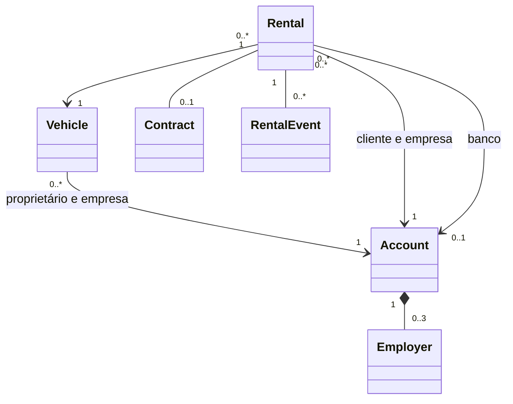

# V1 — base observada no commit 5cfb58f

Reconstrução feita em 11/11/2026 a partir do código versionado; não é documentação original de planejamento.

A base já tinha cadastro/login, frota, pedidos, pareceres e contrato de aluguel. Cliente só podia consultar seus dados; crédito era um conjunto de campos no pedido e no texto de aluguel.

Responsabilidades da base: React constrói páginas; SecurityConfig autentica; ApiController recebe HTTP; RentalService aplica regras; repositórios JPA persistem no PostgreSQL. Os atores eram cliente, empresa e banco. Casos existentes: cadastrar cliente, autenticar, consultar/gerir frota, criar/alterar/consultar/cancelar pedido, avaliar backend/crédito e aceitar/consultar contrato.
